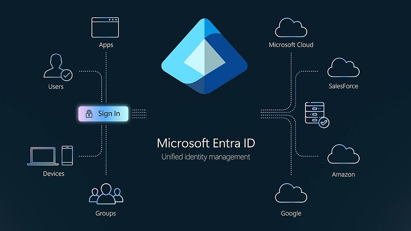
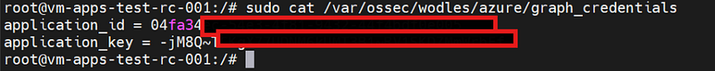
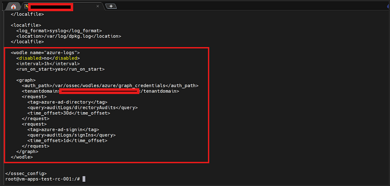
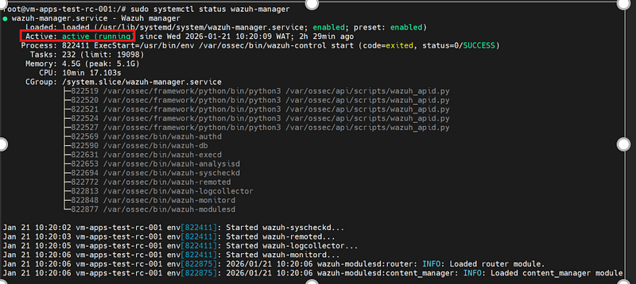
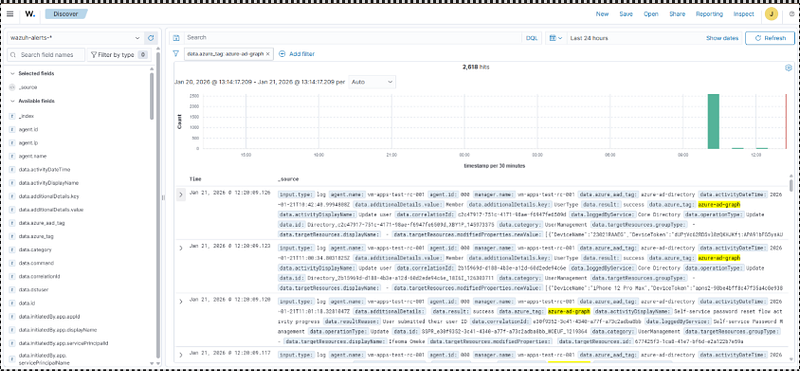

# Integrating Microsoft Entra ID with Wazuh SIEM via Microsoft Graph API: A Complete Guide

📝 Originally published on [Medium](https://medium.com/@aabiodunadeleke/integrating-microsoft-entra-id-with-wazuh-siem-via-microsoft-graph-api-a-complete-guide-0cabed44751f) · 2026-04-18

---

Identity has become one of the most targeted attack surfaces in modern environments. From credential theft and privilege escalation to suspicious sign-ins and unauthorized administrative changes, many attacks begin at the identity layer.



For organizations using Microsoft 365, Microsoft Entra ID (formerly Azure Active Directory) stores critical authentication and directory activity logs that can provide early warning signs of compromise.

By integrating Microsoft Entra ID with Wazuh SIEM through the Microsoft Graph API, security teams can centralize identity telemetry, improve threat detection, monitor administrative activity, and strengthen incident response capabilities.

In this guide, I’ll walk through the complete step-by-step process of integrating Microsoft Entra ID logs into Wazuh SIEM, including:

- Creating the Entra ID application registration
- Assigning Microsoft Graph API permissions
- Configuring Wazuh log collection
- Troubleshooting common issues
- Creating custom detection rules
- Validating log ingestion and monitoring events

Whether you’re building a home lab, improving enterprise visibility, or strengthening your SOC operations, this integration adds significant value to your SIEM environment.

#### Prerequisites

Before starting, ensure you have:

- **Azure AD Access:** Global Administrator or Application Administrator role
- **Wazuh Environment:** Wazuh Manager 4.x installed and running
- **Network Connectivity:** Outbound HTTPS (443) access to `graph.microsoft.com`
- **Basic Knowledge:** Linux command line, JSON, and REST APIs

---

### Part 1: Azure AD Configuration

### Step 1: Create an App Registration

First, we need to create an application registration in Azure AD that Wazuh will use to authenticate and access the Microsoft Graph API.

1. **Navigate to Azure Portal**

- Go to <https://portal.azure.com>
- Sign in with your Global Administrator account

**2. Create App Registration**

- Navigate to **Azure Active Directory** → **App registrations**
- Click **+ New registration**

**Configuration:**

- **Name:** `Wazuh` (or `Wazuh-SIEM-Integration`)
- **Supported account types:** Accounts in this organizational directory only
- **Redirect URI:** Leave blank (not needed for daemon apps)
- Click **Register**

**3. Note Important Information** After creation, copy these values (you’ll need them later):

```
Application (client) ID: 
***
   Directory (tenant) ID: **
*
```

### Step 2: Create Client Secret

1. **Generate Secret**

- In your app registration, go to **Certificates & secrets**
- Click **+ New client secret**
- **Description:** `Wazuh SIEM Integration`
- **Expires:** Choose appropriate duration (I recommend 24 months)
- Click **Add**

**2. Copy the Secret Value IMMEDIATELY**

```
Client Secret: ***
```

⚠️ **IMPORTANT:** You can only see this value once! Store it securely.

### Step 3: Configure API Permissions

This is crucial — we need to grant the application permissions to read audit logs from Microsoft Graph API.

1. **Add Permissions**

- Go to **API permissions**
- Click **+ Add a permission**
- Select **Microsoft Graph**
- Choose **Application permissions** (not Delegated)

**2. Select Required Permissions** Add these permissions one by one:

- `AuditLog.Read.All` - Read audit log data
- `Directory.Read.All` - Read directory data
- `IdentityRiskyUser.Read.All` - Read risky user information
- `IdentityRiskEvent.Read.All` - Read identity risk events
- `User.Read.All` - Read all users' full profiles

**Optional but recommended:**

- `SecurityEvents.Read.All` - Read security events
- `Reports.Read.All` - Read all reports

**3. Grant Admin Consent** ⚠️ **Critical Step:** Click **Grant admin consent for [Your Organization]** Without this, the permissions won’t be active and API calls will fail with 403 errors.

**Step 4: Verify Your Tenant Domain**

You need to know your exact tenant domain name for Wazuh configuration.

**Method 1: From Azure Portal**

- Go to **Azure Active Directory** → **Overview**
- Look for **Primary domain**

**Method 2: Using API**

```
# First, get an access token (we'll test this in a moment)
# Then query:
curl -H 
"Authorization: Bearer YOUR_TOKEN"
 \
  
"https://graph.microsoft.com/v1.0/domains"
 | jq -r 
'.value[] | select(.isInitial == true) | .id'
```

Result: **yourdomain**

**Step 5: Test API Access**

Let’s verify everything works before configuring Wazuh.

1. **Get an Access Token** Create a test script to get a token:

```
curl -X POST 
"https://login.microsoftonline.com/tenet_ID/oauth2/v2.0/token"
 \
     -H 
"Content-Type: application/x-www-form-urlencoded"
 \
     -d 
"client_id="
 \
     -d 
"scope=https://graph.microsoft.com/.default"
 \
     -d 
"client_secret="
 \
     -d 
"grant_type=client_credentials"
 | jq -r 
'.access_token'
```

2. Test Directory Audits Endpoint

```
curl -H 
"Authorization: Bearer YOUR_TOKEN"
 \
     
"https://graph.microsoft.com/v1.0/auditLogs/directoryAudits?\$top=5"
 | jq
```

3. Test Sign-Ins Endpoint

```
curl -H 
"Authorization: Bearer YOUR_TOKEN"
 \
     
"https://graph.microsoft.com/v1.0/auditLogs/signIns?\$top=5"
 | jq
```

If you get JSON data back, congratulations! Your Azure AD configuration is complete. ✅

---

### Part 2: Wazuh Configuration

Now let’s configure Wazuh to collect these logs automatically.

### Step 1: Create the Credentials File

SSH into your Wazuh Manager server.

1. **Create Directory**

```
sudo mkdir -p /var/ossec/wodles/azure
```

2. Create Credentials File

```
sudo nano /var/ossec/wodles/azure/graph_credentials
```

3. **Add Credentials in INI Format** ⚠️ **IMPORTANT:** The format must be exactly like this (no JSON, no quotes):

```
application_id
 = ***
   
application_key
 = *****
```

Note: Use `application_id` and `application_key`, NOT `client_id` and `client_secret`!



**4. Set Proper Permissions**

```
sudo 
chown
 root:wazuh /var/ossec/wodles/azure/graph_credentials
   sudo 
chmod
 640 /var/ossec/wodles/azure/graph_credentials
```

**5. Verify the File**

```
cat /var/ossec/wodles/azure/graph_credentials
```

### Step 2: Configure ossec.conf

1. **Edit Configuration File**

```
sudo nano /var/ossec/etc/ossec.conf
```

**2. Add Azure Logs Wodle** Add this configuration block (usually after the `<office365>` section if you have one):

```
<
wodle
 
name
=
"azure-logs"
>
     
<
disabled
>
no
</
disabled
>
     
<
interval
>
1h
</
interval
>
     
<
run_on_start
>
yes
</
run_on_start
>
     
<
graph
>
       
<
auth_path
>
/var/ossec/wodles/azure/graph_credentials
</
auth_path
>
       
<
tenantdomain
>
*****.onmicrosoft.com
</
tenantdomain
>
       
       
<!-- Directory Audit Logs -->
       
<
request
>
         
<
tag
>
azure-ad-directory
</
tag
>
         
<
query
>
auditLogs/directoryAudits
</
query
>
         
<
time_offset
>
30d
</
time_offset
>
       
</
request
>
       
       
<!-- Sign-In Logs -->
       
<
request
>
         
<
tag
>
azure-ad-signin
</
tag
>
         
<
query
>
auditLogs/signIns
</
query
>
         
<
time_offset
>
1d
</
time_offset
>
       
</
request
>
       
       
<!-- Risk Detections (Optional) -->
       
<
request
>
         
<
tag
>
azure-ad-risk-detections
</
tag
>
         
<
query
>
identityProtection/riskDetections
</
query
>
         
<
time_offset
>
7d
</
time_offset
>
       
</
request
>
       
       
<!-- Risky Users (Optional) -->
       
<
request
>
         
<
tag
>
azure-ad-risky-users
</
tag
>
         
<
query
>
identityProtection/riskyUsers
</
query
>
         
<
time_offset
>
30d
</
time_offset
>
       
</
request
>
     
</
graph
>
   
</
wodle
>
```



**Configuration Breakdown:**

- `interval`: How often to check for new logs (1h = every hour)
- `run_on_start`: Collect logs immediately when Wazuh starts
- `auth_path`: Path to credentials file (points to DIRECTORY, not the file directly)
- `tenantdomain`: Your exact Azure AD tenant domain
- `tag`: Label for identifying log source in Wazuh
- `query`: Microsoft Graph API endpoint to query
- `time_offset`: How far back to look for logs

**3. Save and Exit**

- Press `Ctrl + X`
- Press `Y` to confirm
- Press `Enter` to save

### Step 3: Restart Wazuh Manager

```
sudo systemctl restart wazuh-manager
```

### Step 4: Monitor for Success

```
# Watch the logs in real-time
sudo 
tail
 -f /var/ossec/logs/ossec.log | grep -iE 
"azure|graph"
```

What you should see:

```
2026/01/20 13:16:45 wazuh-modulesd:azure-logs: INFO: Module started.
2026/01/20 13:16:45 wazuh-modulesd:azure-logs: INFO: Starting fetching of logs.
2026/01/20 13:16:45 wazuh-modulesd:azure-logs: INFO: Starting Graphs 
log
 collection 
for
 the domain 
'****g.onmicrosoft.com'
.
2026/01/20 13:16:49 wazuh-modulesd:azure-logs: INFO: Finished Graphs 
log
 collection 
for
 request 
'azure-ad-directory'
.
2026/01/20 13:16:53 wazuh-modulesd:azure-logs: INFO: Finished Graphs 
log
 collection 
for
 request 
'azure-ad-signin'
.
```

If you see this, you’re golden! ✅

### Part 3: Troubleshooting Common Issues

During my implementation, I encountered several issues. Here’s how I solved them:

#### Issue #1: “The authentication file could not be opened: [Errno 21] Is a directory”

Error Message:

```
wazuh-modulesd:azure-logs: ERROR: The authentication file could not be opened: [Errno 21] Is a directory: '/var/ossec/wodles/azure'
```

**Cause:** The `auth_path` was pointing to a directory instead of the credentials file.

**Solution:** Wazuh expects `auth_path` to point to the directory, and it looks for a file named `graph_credentials` inside it.

```
# Rename credentials file to exactly 'graph_credentials'
sudo 
mv
 /var/ossec/wodles/azure/credentials /var/ossec/wodles/azure/graph_credentials
# Update ossec.conf to point to directory only
<auth_path>/var/ossec/wodles/azure</auth_path>
```

**Actually, this didn’t work either!** The final solution was to point directly to the file:

```
<auth_path>/var/ossec/wodles/azure/graph_credentials</auth_path>
```

#### **Issue #2: “The authentication file format is not valid”**

Error Message:

```
wazuh-modulesd:azure-logs: ERROR: The authentication file format is not valid. Make sure that it is composed of only 2 lines with "field = value" format.
```

**Cause:** The credentials file was in JSON format or had incorrect field names.

**Wrong Format (JSON):**

```
{
  
"tenant_id"
:
 
"****"
,
  
"client_id"
:
 
"****"
,
  
"client_secret"
:
 
"****"
}
```

Wrong Format (INI with section header):

```
[graph]
tenant_id
 = ****
client_id
 = ****
secret_value
 = ****
```

Correct Format:

```
application_id
 = 
04
fa34ec-
54
e3-
4
f81-
9432
-
44
f4bdf0e005
application_key
 = <YOUR_CLIENT_SECRET>
```

**Key Points:**

- Exactly 2 lines
- No section headers like `[graph]`
- Use `application_id` and `application_key` (not client\_id/client\_secret)
- No quotes, no JSON formatting
- No `tenant_id` line (it's specified in ossec.conf)

#### Issue #3: No Events Showing in Dashboard

**Symptoms:**

- Wazuh logs show “Finished Graphs log collection” successfully
- No errors in logs
- But no events visible in Wazuh Dashboard

```
# Check if data is being collected
sudo 
tail
 -50 /var/ossec/logs/alerts/alerts.json | grep azure
# Check Discover in Wazuh Dashboard
# Filter: data.azure_tag: azure-ad-graph
```

**Cause:** No audit logs existed in the specified time window.

**Solution:**

1. **Check if API has data:**

```
curl -H 
"Authorization: Bearer YOUR_TOKEN"
 \
     
"https://graph.microsoft.com/v1.0/auditLogs/directoryAudits?\$top=5"
 | jq 
'.value | length'
```

Result: `0` (no logs in last 24 hours)

2. Expand time window:

```
<time_offset>30d</time_offset>  <!-- Changed from 1d to 30d -->
```

3. Add sign-in logs (more frequent):

```
<
request
>
     
<
tag
>
azure-ad-signin
</
tag
>
     
<
query
>
auditLogs/signIns
</
query
>
     
<
time_offset
>
7d
</
time_offset
>
   
</
request
>
```

4. Restart and verify:

```
sudo systemctl restart wazuh-manager
   sudo 
tail
 -f /var/ossec/logs/ossec.log | grep azure
```

After this, I started seeing events! 🎉

### Issue #4: Events in Discover but Not in Events View

**Symptoms:**

- Data visible in **Discover** with filter `data.azure_tag: azure-ad-graph`
- Events tab shows nothing for Microsoft Graph API
- 2,598 hits in Discover

**Cause:** Wazuh needs decoders and rules to process and categorize the logs.

**Solution:** Create custom decoders and rules (covered in Part 4).

---

### Part 4: Creating Custom Rules and Decoders

Raw logs are collected, but we need to decode them and create detection rules for meaningful alerts.

### Step 1: Create Azure Decoders

Decoders parse the JSON logs from Microsoft Graph API.

1. **Create Decoder File**

```
sudo nano /var/ossec/etc/decoders/azure_decoders.xml
```

2. Add Decoder Configuration

```
<!--
     - Azure AD Graph API decoders
     - Created for Microsoft Graph API integration
   -->
   
<
decoder
 
name
=
"azure-ad-graph"
>
     
<
prematch
>
azure_tag
</
prematch
>
   
</
decoder
>
   
<
decoder
 
name
=
"azure-ad-graph-signin"
>
     
<
parent
>
azure-ad-graph
</
parent
>
     
<
regex
>
azure-ad-signin
</
regex
>
   
</
decoder
>
   
<
decoder
 
name
=
"azure-ad-graph-directory"
>
     
<
parent
>
azure-ad-graph
</
parent
>
     
<
regex
>
azure-ad-directory
</
regex
>
   
</
decoder
>
```

3. Save and Exit

### Step 2: Create Azure Detection Rules

Rules trigger alerts based on specific conditions in the logs.

1. **Create Rules File**

```
sudo nano /var/ossec/etc/rules/azure_rules.xml
```

2. Add Rule Configuration

```
<!--
     - Azure AD Graph API rules
     - Created for Microsoft Graph API integration
   -->
   
<
group
 
name
=
"azure,azure_ad,"
>
     
<!-- Base rule for Azure Graph logs -->
     
<
rule
 
id
=
"100100"
 
level
=
"0"
>
       
<
decoded_as
>
azure-ad-graph
</
decoded_as
>
       
<
description
>
Azure AD Graph API events
</
description
>
     
</
rule
>
     
<!-- Sign-in events -->
     
<
rule
 
id
=
"100101"
 
level
=
"3"
>
       
<
if_sid
>
100100
</
if_sid
>
       
<
field
 
name
=
"azure_aad_tag"
>
azure-ad-signin
</
field
>
       
<
description
>
Azure AD: Successful user sign-in
</
description
>
       
<
group
>
authentication_success,pci_dss_10.2.5,gdpr_IV_32.2,hipaa_164.312.b,nist_800_53_AU.14,nist_800_53_AC.7,
</
group
>
     
</
rule
>
     
<
rule
 
id
=
"100102"
 
level
=
"5"
>
       
<
if_sid
>
100101
</
if_sid
>
       
<
field
 
name
=
"status.errorCode"
>
\.+
</
field
>
       
<
description
>
Azure AD: Failed user sign-in attempt
</
description
>
       
<
group
>
authentication_failed,pci_dss_10.2.4,pci_dss_10.2.5,gdpr_IV_35.7.d,gdpr_IV_32.2,hipaa_164.312.b,nist_800_53_AU.14,nist_800_53_AC.7,
</
group
>
     
</
rule
>
     
<
rule
 
id
=
"100103"
 
level
=
"10"
 
frequency
=
"5"
 
timeframe
=
"300"
>
       
<
if_matched_sid
>
100102
</
if_matched_sid
>
       
<
same_source_ip
 />
       
<
description
>
Azure AD: Multiple failed sign-in attempts from same IP
</
description
>
       
<
group
>
authentication_failures,pci_dss_10.2.4,pci_dss_10.2.5,pci_dss_11.4,gdpr_IV_35.7.d,
</
group
>
     
</
rule
>
     
<
rule
 
id
=
"100104"
 
level
=
"8"
>
       
<
if_sid
>
100101
</
if_sid
>
       
<
field
 
name
=
"riskState"
>
atRisk|confirmedCompromised
</
field
>
       
<
description
>
Azure AD: Sign-in from risky user account
</
description
>
       
<
group
>
authentication_failed,pci_dss_10.2.4,gdpr_IV_35.7.d,hipaa_164.312.b,
</
group
>
     
</
rule
>
     
<!-- Directory audit events -->
     
<
rule
 
id
=
"100110"
 
level
=
"3"
>
       
<
if_sid
>
100100
</
if_sid
>
       
<
field
 
name
=
"azure_aad_tag"
>
azure-ad-directory
</
field
>
       
<
description
>
Azure AD: Directory audit event
</
description
>
       
<
group
>
gdpr_IV_30.1.g,
</
group
>
     
</
rule
>
     
<
rule
 
id
=
"100111"
 
level
=
"5"
>
       
<
if_sid
>
100110
</
if_sid
>
       
<
field
 
name
=
"activityDisplayName"
>
Add user|Delete user
</
field
>
       
<
description
>
Azure AD: User account created or deleted
</
description
>
       
<
group
>
gdpr_IV_30.1.g,
</
group
>
     
</
rule
>
     
<
rule
 
id
=
"100112"
 
level
=
"8"
>
       
<
if_sid
>
100110
</
if_sid
>
       
<
field
 
name
=
"activityDisplayName"
>
Add member to role|Remove member from role
</
field
>
       
<
description
>
Azure AD: User role assignment changed
</
description
>
       
<
group
>
gdpr_IV_30.1.g,pci_dss_10.2.5,
</
group
>
     
</
rule
>
     
<
rule
 
id
=
"100113"
 
level
=
"10"
>
       
<
if_sid
>
100110
</
if_sid
>
       
<
field
 
name
=
"activityDisplayName"
>
Reset user password|Change user password
</
field
>
       
<
description
>
Azure AD: User password changed or reset
</
description
>
       
<
group
>
gdpr_IV_30.1.g,pci_dss_10.2.5,
</
group
>
     
</
rule
>
   
</
group
>
```

3. Save and Exit

**Rule Breakdown:**

- **100100:** Base rule for all Azure AD events (level 0 = no alert, just categorization)
- **100101:** Successful sign-ins (level 3 = low priority)
- **100102:** Failed sign-in attempts (level 5 = medium priority)
- **100103:** Multiple failed attempts from same IP (level 10 = high priority, potential brute force)
- **100104:** Sign-in from risky account (level 8 = high priority)
- **100110:** Directory changes (level 3 = informational)
- **100111:** User creation/deletion (level 5 = medium priority)
- **100112:** Role assignment changes (level 8 = high priority, privilege escalation)
- **100113:** Password changes (level 10 = high priority, potential compromise)

### Step 3: Test Configuration

```
# Test decoder/rule syntax
sudo /var/ossec/bin/wazuh-logtest
```

Paste a sample log from your alerts:

```
{"id": "90d86fb5-3dc3-439f-8327-c00", "createdDateTime": "2026-01-20T23:17:15Z", "userDisplayName": "Samuel Ogala", "userPrincipalName": "samuel@gmail.com", "azure_tag": "azure-ad-graph", "azure_aad_tag": "azure-ad-signin"}
```

Press `Ctrl+D` to exit.

#### Step 4: Restart Wazuh

```
sudo systemctl restart wazuh-manager
```



#### Step 5: Verify Rules Are Loaded

```
# Check if rules loaded
sudo grep -i 
"azure"
 /var/ossec/logs/ossec.log
# List Azure rules
sudo /var/ossec/bin/wazuh-logtest -l | grep azure
```

### Part 5: Validation and Monitoring

### Step 1: Verify Data Ingestion

1. **Check Wazuh Logs**

```
sudo tail -30 /var/ossec/logs/ossec.log | grep -i azure
```

Expected output:

```
2026/01/21 08:27:13 wazuh-modulesd:azure-logs: INFO: Starting fetching of logs.
   2026/01/21 08:27:17 wazuh-modulesd:azure-logs: INFO: Finished Graphs 
log
 collection 
for
 request 
'azure-ad-directory'
.
   2026/01/21 08:27:21 wazuh-modulesd:azure-logs: INFO: Finished Graphs 
log
 collection 
for
 request 
'azure-ad-signin'
.
```

2. Check Alerts File

```
sudo grep -r "azure-ad" /var/ossec/logs/alerts/ 2>/dev/null | head -5
```

3. Check Database

```
sudo 
ls
 -lh /var/ossec/wodles/azure/azure.db
   sudo 
stat
 /var/ossec/wodles/azure/azure.db
```

### Step 2: View Events in Wazuh Dashboard

1. **Access Dashboard**

- Open Wazuh Dashboard in your browser
- Navigate to **Discover** or **Threat Hunting**

**2. Add Filters**

```
data.azure_tag: azure-ad-graph
```

**3. You Should See:**

- Sign-in events with user details, IP addresses, locations
- Directory audit events for user/group/role changes
- Risk detections if available
- Proper rule IDs (100101, 100102, etc.)



### Conclusion

Integrating Microsoft Entra ID with Wazuh SIEM using Microsoft Graph API is a practical and powerful way to improve identity monitoring.

It gives defenders visibility into authentication activity, privilege changes, risky behavior, and administrative actions, all within a centralized SIEM platform.

When combined with endpoint telemetry from Microsoft Defender and system logs from servers and workstations, Wazuh becomes a highly capable security monitoring solution.

If you’re building a modern SOC, improving blue team visibility, or strengthening security operations, this integration is well worth implementing.

#CyberSecurity #Wazuh #SIEM #MicrosoftEntraID #AzureAD #SOC #BlueTeam #ThreatDetection #SecurityOperations #MicrosoftGraphAPI
